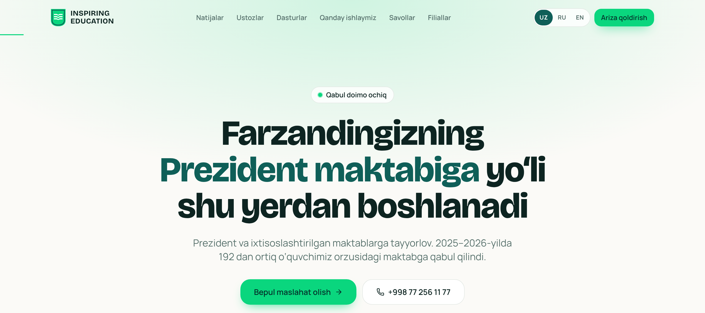
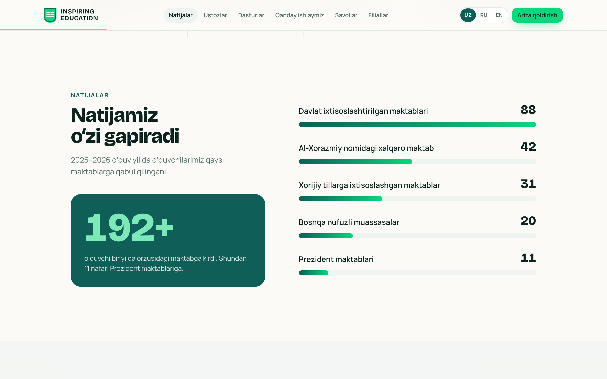

<div align="center">


# Inspiring Education

**Prezident va ixtisoslashtirilgan maktablarga tayyorlov markazining rasmiy sayti**

[](https://github.com/muhiddinovoff/inspiring-site/actions/workflows/deploy.yml)
[](https://github.com/muhiddinovoff/inspiring-site/actions/workflows/ci.yml)


[**Saytni ochish →**](https://muhiddinovoff.github.io/inspiring-site/)



</div>

## Imkoniyatlar

- **Uch tilda** — o‘zbek, rus, ingliz. Til tepadagi UZ / RU / EN tugmasi bilan almashadi, eslab qolinadi, havolada `?lang=ru` bilan ham beriladi.
- **Silliq animatsiyalar** — Lenis inersion skroll, bosh ekrandagi 3D “ekran” (scroll animatsiya), sanab ko‘tariladigan raqamlar, skroll bilan to‘ladigan yo‘l xaritasi, parallax.
- **Ariza formasi** — ikki maydon, `+998` telefon maskasi, sinf tanlash; Google Sheets / Telegram'ga ulanadi ([qo‘llanma](docs/lead-endpoint.md)).
- **Qulaylik** — bosiladigan telefon va xarita havolalari, shahar bo‘yicha filial filtri, mobil pastki panel, qorong‘i rejim.
- **Sifat** — klaviatura bilan boshqarish, “harakatni kamaytirish” sozlamasini hurmat qilish, SEO va ulashish teglari, sitemap.

<table>
  <tr>
    <td width="68%"></td>
    <td></td>
  </tr>
</table>

## Texnologiyalar

| | |
|---|---|
| Asos | [Vite](https://vite.dev), [React 19](https://react.dev), TypeScript |
| Dizayn | [Tailwind CSS 4](https://tailwindcss.com), [shadcn/ui](https://ui.shadcn.com) (Radix), [lucide](https://lucide.dev) ikonkalari |
| Animatsiya | [Framer Motion](https://motion.dev), [Lenis](https://lenis.darkroom.engineering) |
| Shriftlar | Bricolage Grotesque, Manrope, Onest (kirill) — loyiha ichida, Google'ga so‘rov yo‘q |
| Sifat | oxlint, Prettier, Vitest, GitHub Actions |

## Ishga tushirish

Node.js 22 kerak.

```bash
npm install
npm run dev        # http://localhost:5173
```

| Buyruq | Vazifasi |
|---|---|
| `npm run dev` | ishlab chiqish serveri |
| `npm run build` | tayyor sayt `dist/` ga |
| `npm run preview` | build natijasini ko‘rish |
| `npm run check` | lint + format + test + build (push'dan oldin) |
| `npm run format` | kodni formatlash |

## Tuzilma

```
src/
├── components/
│   ├── ui/            shadcn komponentlari (button, dialog, accordion, container-scroll-animation …)
│   ├── sections/      sahifa bo‘limlari (hero, results, teachers, branches, lead-form …)
│   └── motion/        Reveal, CountUp animatsiya yordamchilari
├── i18n/              uz.ts · ru.ts · en.ts tarjimalar va til konteksti
├── data/              raqamlar, havolalar, filiallar, ustozlar (tildan mustaqil)
├── hooks/             silliq skroll
└── lib/               telefon formati, arizani yuborish, cn()
public/                rasmlar, ikonkalar, robots.txt, sitemap.xml
docs/                  qo‘llanmalar va README rasmlari
```

## Ma’lumotni o‘zgartirish

| Nima | Qayerda |
|---|---|
| Barcha matnlar | `src/i18n/uz.ts`, `ru.ts`, `en.ts` (tuzilmasi bir xil; biror tilda kalit tushib qolsa, build xato beradi) |
| Natija raqamlari, filiallar, telefon, havolalar | `src/data/site.ts` |
| Ustozlar | `src/data/teachers.ts` + rasmlar `public/teachers/` |
| Ranglar va shriftlar | `src/index.css` |

## Deploy

`main` ga har bir push'da [`deploy.yml`](.github/workflows/deploy.yml) tekshiradi, build qiladi va GitHub Pages'ga chiqaradi: **https://muhiddinovoff.github.io/inspiring-site/**
Boshqa branch va PR'larda [`ci.yml`](.github/workflows/ci.yml) faqat tekshiradi.

Bir martalik sozlash: **Settings → Pages → Build and deployment → Source: GitHub Actions**.

Repo **Netlify**'ga ham ulangan: u [`netlify.toml`](netlify.toml) bo‘yicha `main` ni o‘zi build qiladi va har bir PR uchun preview havola beradi. Ariza manzilini Netlify'da **Site configuration → Environment variables → `VITE_LEAD_ENDPOINT`** ga yozing.
Ariza manzili: **Settings → Secrets and variables → Actions → Variables → `VITE_LEAD_ENDPOINT`** ([batafsil](docs/lead-endpoint.md)).

## Aloqa

📞 +998 77 256 11 77 · Telegram va Instagram: [@inspiringuz](https://t.me/inspiringuz)

---

<sub>© 2026 Inspiring Education. Barcha huquqlar himoyalangan — [LICENSE](LICENSE).</sub>
